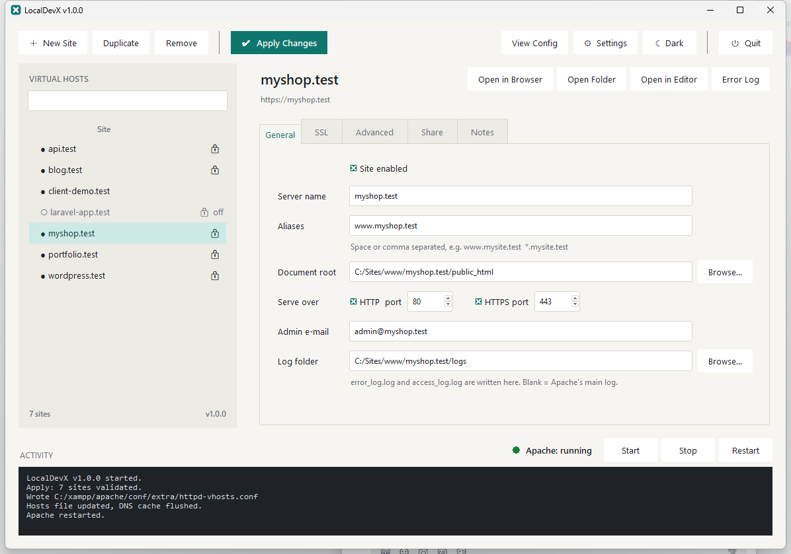
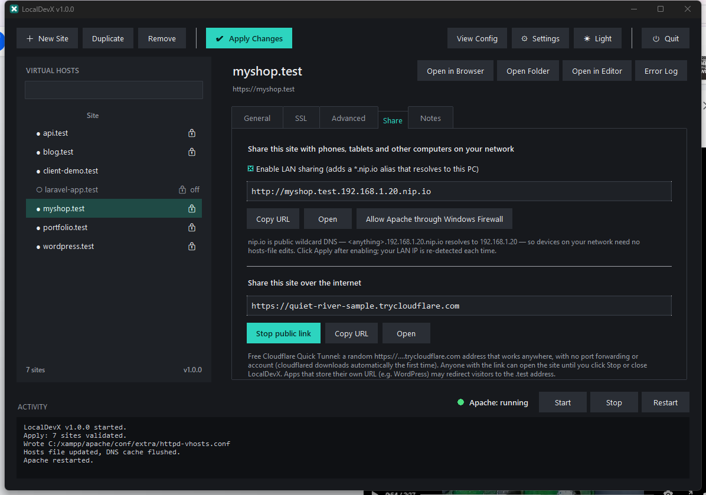
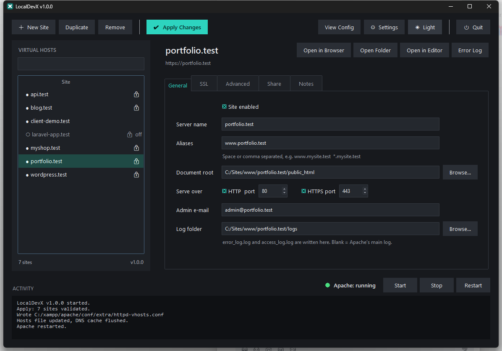
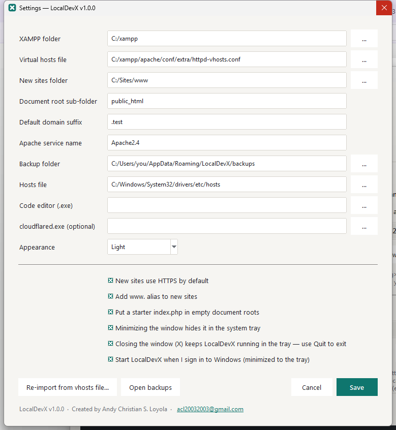

<p align="center">
  
</p>

<h1 align="center">LocalDevX</h1>

<p align="center">
  <b>Real local domains for XAMPP on Windows: <code>https://myshop.test</code> in one click.</b><br>
  Share them with your phone over Wi-Fi, or with anyone on the internet.
</p>

<p align="center">
  <a href="downloads/LocalDevX-1.0.0-setup.exe"><b>⬇ Download the installer (v1.0.0)</b></a>
  &nbsp;·&nbsp;
  <a href="downloads/LocalDevX-1.0.0-portable.zip">Portable version (no install)</a>
</p>

<p align="center">
  
  
  
  
</p>

<p align="center">
  
</p>

---

## Why LocalDevX?

Working on more than one site in XAMPP usually means `http://localhost/project-1`, `localhost/project-2`
and broken absolute links. The alternative is a 20-minute ritual every time you add a site:

1. Edit `httpd-vhosts.conf` by hand, and hope you didn't break Apache.
2. Open Notepad *as Administrator* to edit the hosts file.
3. Fight OpenSSL to get HTTPS working, then click past "Your connection is not private" forever.
4. Restart Apache and flush DNS.
5. Repeat for every project. Then try to show the site to a client or open it on your phone.

**LocalDevX does all of that from one window.** Type a name, click **Apply Changes**, and
`https://myshop.test` is live with a trusted padlock. It's a dark-mode-ready Windows app that keeps
XAMPP, and adds what XAMPP never had.

## Features

### 🌐 Real domains, done properly
- One site per project: `myshop.test`, `blog.test`, `api.test`. Aliases and wildcards (`*.myshop.test`) are supported.
- **One-click Apply**: LocalDevX writes the virtual hosts, updates the hosts file, flushes DNS and restarts Apache.
- **Safe by design**: every change is checked with `httpd -t` *before* anything is written. If Apache would reject
  the config, nothing changes. Every file is backed up first.
- **Imports your existing setup**: it reads the `httpd-vhosts.conf` you already have, so you don't start from scratch.

### 🔒 HTTPS with a real padlock
- LocalDevX has its own local certificate authority. Trust it once with one click, and every site gets a valid
  certificate in Chrome and Edge, including aliases and wildcards.
- Custom HTTP/HTTPS ports, with `Listen` lines added for you.

### 📱 Share on your network
- Turn on **LAN sharing** and a site gets an address like `myshop.test.192.168.1.20.nip.io`.
- Phones, tablets and other PCs open it directly. There are no hosts files to edit on those devices.
- One-click Windows Firewall rule.

### 🚀 Share on the internet
- Click **Start public link** and you get a `https://….trycloudflare.com` address that works anywhere.
- No port forwarding, no router settings, no account. It's powered by Cloudflare Quick Tunnels, and `cloudflared`
  downloads itself the first time you use it.
- The link stops when you click Stop or quit the app, so nothing stays exposed by accident.

<p align="center">
  
</p>

### 🖥️ Feels like a native Windows app
- **Light and dark themes**: follow Windows or pick one. The title bar matches.
- **System tray**: closing or minimizing hides LocalDevX in the tray, and public links keep running. Start, stop and
  restart Apache from the tray menu.
- **Start with Windows**: starts quietly in the tray when you sign in, without a UAC prompt.
- **One copy at a time**: opening it again just brings the running window to the front.
- **Dedicated Quit button** for when you really want it gone.
- Shortcuts to open each site in the browser, its folder, your code editor (VS Code by default) or its error log.

<p align="center">
  
</p>

## Get started

1. Install [XAMPP](https://www.apachefriends.org/) if you haven't already. LocalDevX expects `C:\xampp`, and
   you can change this in Settings.
2. Download and run **[LocalDevX-1.0.0-setup.exe](downloads/LocalDevX-1.0.0-setup.exe)**.
   - If you'd rather not install, unzip
     **[LocalDevX-1.0.0-portable.zip](downloads/LocalDevX-1.0.0-portable.zip)** anywhere and run `LocalDevX.exe`.
3. On first launch LocalDevX offers to import your existing virtual hosts.
4. Click **New Site**, type a name, then click **Apply Changes**. Open `https://yoursite.test`. Done.
5. *(Optional)* On the site's **SSL** tab, click **Trust CA in Windows** once for a green padlock on every site.

> **"Windows protected your PC"?** LocalDevX isn't code-signed yet, so SmartScreen warns about new downloads.
> Click **More info → Run anyway**. The full source is in this repository, and you can build the `.exe` yourself
> (see below).

LocalDevX asks for Administrator rights because it edits the hosts file, controls the Apache service and
trusts certificates.

## Requirements

- Windows 10 or 11 (64-bit)
- XAMPP, or any Apache 2.4 for Windows
- To run from source: Python 3.10+. Only the standard library is used, with no `pip install`.

## Settings

<p align="center">
  
</p>

Your sites and settings live in `%APPDATA%\LocalDevX`. The installed version, the portable version and the
source version all share them, so you can switch between them freely.

## Run or build from source

```bat
:: run it
LocalDevX.bat

:: build the installer, the portable folder and the zip into .\release
pip install pyinstaller
winget install JRSoftware.InnoSetup
build.bat
```

The version number lives in one place, `APP_VERSION` in `localdevx/__init__.py`. The window title, tray,
installer and `.exe` properties all read it from there.

<details>
<summary>Project layout</summary>

| Path | What it is |
|---|---|
| `localdevx/ui.py` | The Tkinter interface, tray integration and command-line switches |
| `localdevx/core.py` | "Apply Changes": validate, create folders, certificates, write config, restart |
| `localdevx/apache.py` | vhosts generation, `httpd -t` checks, Apache service control, firewall rule |
| `localdevx/hosts.py` | Managed block in the Windows hosts file |
| `localdevx/sslcerts.py` | Local certificate authority and site certificates (OpenSSL from XAMPP) |
| `localdevx/tunnel.py` | Cloudflare Quick Tunnel public links |
| `localdevx/tray.py` | Native Windows tray icon and app icon (pure `ctypes`) |
| `localdevx/startup.py` | Start with Windows (Task Scheduler) and the single-instance lock |
| `localdevx/theme.py` | Light and dark themes |
| `installer/LocalDevX.iss` | Inno Setup installer script |
| `build.py` | Release build: PyInstaller, portable zip and installer |

</details>

## What "Apply Changes" does, exactly

1. Validates every site: names, duplicate host names and aliases.
2. Creates missing folders (`public_html`, `logs`), and a starter `index.php` if the document root is empty.
3. Issues certificates for HTTPS sites that need one.
4. Generates the new `httpd-vhosts.conf` and tests it with `httpd -t`. **If Apache rejects it, nothing is written.**
5. Backs up and rewrites `httpd-vhosts.conf`. `http://localhost` keeps pointing at `htdocs`.
6. Backs up the hosts file and updates its own marked block, leaving your other entries alone. Then it flushes DNS.
7. Restarts Apache.

## Changelog

**1.0.0**: first public release
- Virtual hosts for XAMPP with one-click Apply, a local HTTPS certificate authority and hosts-file management
- LAN sharing (nip.io) and internet sharing (Cloudflare Quick Tunnel)
- Light and dark themes, system tray, Start with Windows, single instance
- Windows installer and portable version

## Author

Created by **Andy Christian S. Loyola** ([acl20032003@gmail.com](mailto:acl20032003@gmail.com)).

If LocalDevX saves you some time, a ⭐ on the repo is appreciated. Bug reports and ideas are welcome in
[Issues](../../issues).
